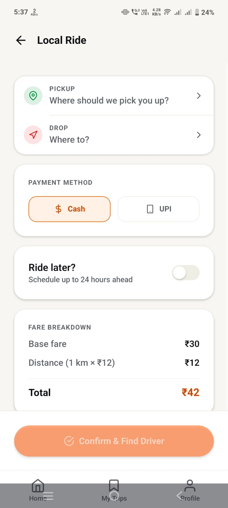
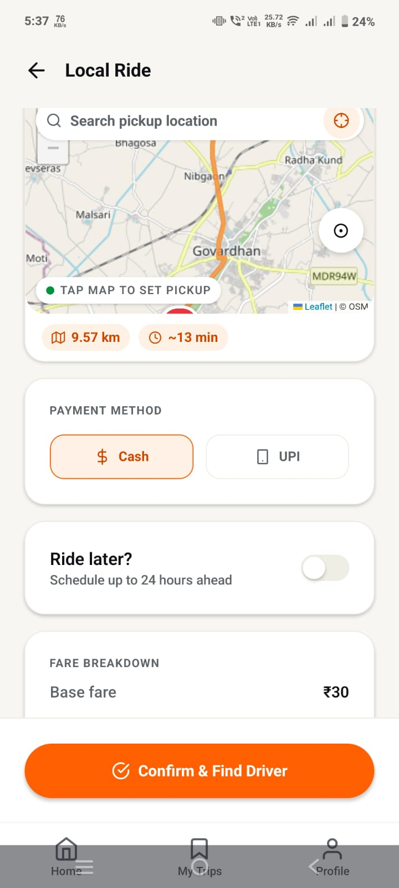
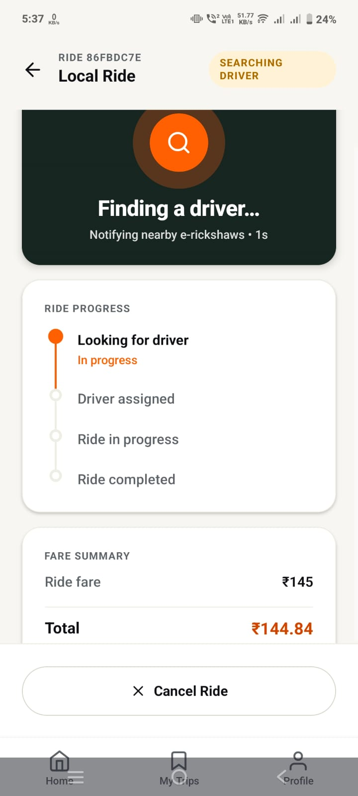
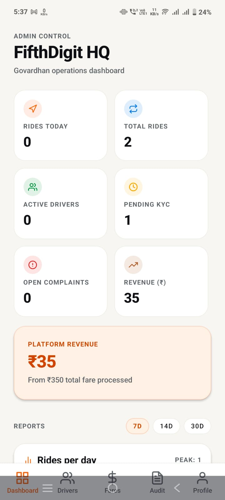

# FifthDigit

A pilgrim services platform for Govardhan (Mathura district, Braj), built as an MVP for a proposed 60 to 90 day pilot with the UP Braj Teerth Vikas Parishad.

FifthDigit brings three things a pilgrim needs into one app:

1. **E-rickshaw booking** for local rides and parikrama routes, with verified drivers and fixed, admin-set fares.
2. **Dharamshala and guest house discovery**, with verified listings, photos, facilities, and one-tap Call, WhatsApp, or Directions.
3. **Temples**, with darshan timings, aarti schedules, live open/closed status in IST, crowd level, and prasad ordering.

It also gives the administration a dashboard to see demand, drivers, routes, and complaints across the region.

## Screenshots

<table>
  <tr>
    <td align="center"></td>
    <td align="center"></td>
    <td align="center"></td>
    <td align="center"></td>
  </tr>
  <tr>
    <td align="center"><b>Book a ride</b><br/>Pickup, drop, payment, and a clear fare breakdown</td>
    <td align="center"><b>Pick on the map</b><br/>Route distance and time across Govardhan</td>
    <td align="center"><b>Live dispatch</b><br/>Nearby drivers notified in real time</td>
    <td align="center"><b>Admin dashboard</b><br/>Rides, drivers, KYC, complaints, revenue</td>
  </tr>
</table>

## Why

Govardhan sees very heavy pilgrim traffic all year, with big spikes on Ekadashi, Purnima, Amavasya, weekends, and festivals. E-rickshaws already move most of these people, but:

- First-time pilgrims don't know what a fair fare is, so every ride starts with bargaining.
- There is no easy way to know whether a driver is verified.
- Drivers crowd a few spots while other areas have none.
- Finding a clean, affordable, trustworthy place to stay is mostly word of mouth.
- The administration has no live view of demand, supply, or trouble spots.

FifthDigit doesn't replace the existing e-rickshaw network. It puts structure around it.

## Features

### Passenger
- Phone number + OTP login
- Home screen with Local Ride and the parikrama packages: Poochari (about 12 km), Radhakund (about 7 km), and Combined
- Local rides between curated Govardhan landmarks or searched places, limited to the service region. Fare is base fare plus a per-km rate
- Parikrama rides at a fixed package price set by the admin
- UPI or cash, ride now or schedule for later
- Live driver tracking and a status timeline over WebSocket
- 4-digit ride PIN that the driver must enter before the ride can start
- Cancel with a reason, rate the driver, raise a complaint
- Ride history and profile
- Stays tab: browse and filter verified dharamshalas and guest houses, then call, WhatsApp, or get directions
- Temples tab: darshan slots, aarti list, live open/closed status, crowd level, and prasad ordering

### Driver
- KYC with Aadhaar, vehicle RC, and profile photo, which an admin approves or rejects
- Go online/offline and share location
- Receive incoming ride requests in real time and accept them. A ride can only be accepted by one driver
- Start the ride with the passenger's PIN, then complete it
- Earnings and withdrawal requests

### Admin
- Dashboard with ride volume over time, a driver leaderboard, and top routes
- Approve or reject driver KYC, with access to private KYC documents through short-lived links
- Set fares: base fare, per-km rate, and parikrama package prices
- Manage landmarks and the service region
- Full ride audit log
- Handle complaints and driver withdrawals
- Create, edit, and verify dharamshalas and guest houses
- Create and edit temples, darshan timings, aarti, crowd level, and prasad items
- View prasad orders

## Tech stack

| Layer | Technology |
| --- | --- |
| Mobile and web app | Expo SDK 54 (React Native 0.81), expo-router, TypeScript, pnpm |
| Backend API | NestJS 10, TypeScript, Node 24 |
| Database | MongoDB Atlas via Mongoose |
| Realtime | WebSocket at `/api/ws` for ride dispatch and live tracking |
| Auth | Phone OTP, JWT (HS256) |
| Maps and routing | OpenStreetMap (Nominatim + OSRM) by default, Google Maps optional |
| Image storage | Google Cloud Storage with signed upload URLs |
| Logging | nestjs-pino, structured JSON with request IDs and PII redaction |
| Deployment | Docker Compose behind nginx (HTTPS) on a VM, Android builds through EAS |

## Project structure

```
mobile-app/
├── backend-ts/          NestJS API (the live backend)
│   ├── src/modules/     auth, users, config, drivers, rides, ratings, geo,
│   │                    admin, stays, temples, prasad, uploads
│   ├── src/seed/        sample data seeded on first boot
│   ├── Dockerfile
│   └── docker-compose.yml
├── frontend/            Expo app (Android, iOS, web)
│   ├── app/(passenger)/ passenger screens
│   ├── app/(driver)/    driver screens
│   ├── app/(admin)/     admin screens
│   ├── src/             API client, uploads, shared components and helpers
│   └── eas.json         EAS build profiles
├── docs/screenshots/    app screenshots used in this README
├── startup/             proposal documents for the UP Braj Teerth Vikas Parishad
└── RUN_AND_DEPLOY.md    detailed run and deploy notes
```

## Running locally

### Prerequisites
- Node 24 or later
- pnpm (`corepack enable pnpm`)
- A MongoDB Atlas cluster, or MongoDB running locally
- Expo Go on your phone if you want to test on a device

### Backend

```bash
cd backend-ts
npm install
cp .env.example .env      # set MONGO_URL, DB_NAME, JWT_SECRET, ADMIN_PHONES
npm run start:dev
```

The API runs on `http://localhost:3002`, with every route under `/api`. On first boot it creates indexes and seeds the admin user, fare config, landmarks, and sample stays and temples.

Image uploads need a GCS bucket (`GCS_BUCKET` plus credentials, see `.env.example`). If `GCS_BUCKET` is left empty, uploads are turned off for local development, but stays and temples still need at least one photo URL.

### Frontend

```bash
cd frontend
pnpm install              # also applies the expo-location patch
cp .env.example .env      # set EXPO_PUBLIC_BACKEND_URL (no trailing /api)
pnpm web                  # browser at http://localhost:8081
# or
pnpm start                # scan the QR code with Expo Go
```

To test on a phone over LAN, set `EXPO_PUBLIC_BACKEND_URL=http://<your-laptop-ip>:3002` and keep the phone and laptop on the same Wi-Fi network.

Two things to know about the frontend setup:
- `pnpm-workspace.yaml` sets `nodeLinker: hoisted`, because Metro can't resolve pnpm's default symlinked packages.
- `expo-location` is patched (`frontend/patches/`) to fix a crash with newer versions of Expo Go.

### Demo logins

The OTP is mocked for the MVP. Every account uses OTP `123456`.

| Role | Phone |
| --- | --- |
| Admin | `9999999999` |
| Passenger | any 10-digit number |
| Driver | any 10-digit number, then submit KYC and approve it from the admin account |

## Deployment

### Backend (VM with Docker)

```bash
cd backend-ts
cp .env.example .env      # production values: Atlas URI, strong JWT_SECRET, GCS settings
docker compose up -d --build
```

The container publishes the API on `127.0.0.1:3002`. An nginx reverse proxy on the VM terminates HTTPS and forwards to it. The GCS service account key is mounted into the container at runtime and is never baked into the image. Add the VM's IP to the Atlas network access list.

To redeploy:

```bash
git pull && docker compose up -d --build
```

### Android app (EAS)

```bash
cd frontend
eas build --platform android --profile preview      # installable APK
eas build --platform android --profile production
```

The `preview` and `production` profiles in `eas.json` already point `EXPO_PUBLIC_BACKEND_URL` at the deployed API.

## API overview

All routes are under `/api`. Errors come back as `{ "detail": "..." }`. Send the token as `Authorization: Bearer <token>` or as `X-Auth-Token`.

| Area | Routes |
| --- | --- |
| Auth | `POST /auth/send-otp`, `POST /auth/verify-otp`, `GET /auth/me` |
| Rides | `POST /rides`, `GET /rides/mine`, `GET /rides/:id`, plus accept, start, complete, and cancel actions |
| Drivers | `POST /drivers/kyc`, `POST /drivers/online`, `POST /drivers/location`, `GET /drivers/incoming-rides`, `GET /drivers/earnings`, `POST /drivers/withdraw` |
| Ratings | rate a ride, raise a complaint, view user ratings |
| Geo | `GET /geo/region`, `/geo/search`, `/geo/reverse`, `/geo/route` |
| Stays | `GET /stays`, `GET /stays/:id`, admin CRUD under `/admin/stays` |
| Temples | `GET /temples`, `GET /temples/:id`, admin CRUD under `/admin/temples` |
| Prasad | `POST /prasad/orders`, `GET /prasad/orders/mine`, `GET /admin/prasad/orders` |
| Uploads | `POST /uploads/sign`, `POST /uploads/sign-read`, `GET /uploads/status` |
| Admin | dashboard, reports, fares, landmarks, drivers, ride audit, complaints, withdrawals |
| Realtime | WebSocket at `/api/ws?token=<jwt>` |

### How image uploads work

1. The app asks the API for signed upload URLs (`POST /api/uploads/sign`).
2. The app uploads the images straight to Google Cloud Storage, retrying if needed.
3. The app creates the stay, temple, or KYC record with the image URLs.
4. Before saving anything, the API checks that every image exists, is really an image, and is under the size limit. If any check fails, nothing is saved.

This way a listing is never saved with missing photos, and image data never passes through the API server.

## Current limitations

- OTP is mocked (`123456`). A real SMS provider is needed before launch.
- Prasad payments are in test mode and orders are marked paid straight away. Razorpay (or a similar gateway) will replace this step without changing the order format.
- Stays are listed for discovery and inquiry only. There is no in-app room booking yet.

## Roadmap

- Real OTP and payment gateway
- Hindi and other regional languages
- QR-based booking at parking areas, bus stands, and parikrama points
- Festival crowd planning and route advisories
- Expansion beyond Govardhan to Mathura, Vrindavan, Barsana, Nandgaon, and Gokul
